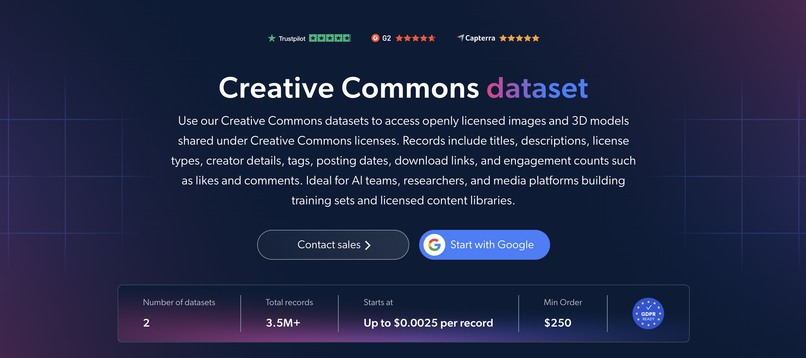

# Creative Commons 图片数据集样本

<h2>包含 1000 张知识共享图像的示例数据集</h2>

<a href="https://www.bright.cn/products/datasets/creative-commons">
   
</a>

一个包含 1000 张开放许可图像的知识共享数据集示例。该数据集使用 <b>Bright Data API</b> 提取。

<h2>数据集中包含的部分数据点：</h2>

* ```url```：图像来源页面的 URL
* ```title```：图像标题
* ```description```：图像描述
* ```image_url```：图像的直接 URL
* ```creators```：图像创作者
* ```license```：图像的知识共享许可类型
* ```keyword```：用于查找图像的关键词
* ```type```：图像类型
* ```domain```：图像的来源域名
* ```date_taken```：图像的拍摄或上传日期
* ```dimensions```：图像尺寸

这是“知识共享图像（公开数据）”数据集的示例子集，该数据集包含超过 <b>3,500,000 张图像</b>。

可用的数据集文件格式：<b>JSON、NDJSON、JSON Lines、CSV、XLSX 或 Parquet。文件还可选择压缩为 .gz 格式</b>。

数据集交付方式选项：<b>电子邮件、API 下载、Webhook、Amazon S3、Google Cloud Storage、Google Cloud Pub/Sub、Microsoft Azure、Snowflake、SFTP</b>。

更新频率：<b>一次性、每日、每周、每月、每季度、每半年或自定义</b>。

可在已提取的数据点基础上添加数据增强：<b>根据需求提供。</b>

<b>[获取完整的知识共享数据集](https://www.bright.cn/products/datasets/creative-commons)</b>。

<a href="https://www.bright.cn/products/datasets/creative-commons">
</a>

<h2>知识共享数据集有哪些用例？</h2>

<h3>1. AI 训练数据</h3>
AI 团队使用知识共享数据集，从开放许可内容中构建图像训练集。按许可类型、关键词和尺寸进行筛选，可以明确使用条款，并轻松组建用于图像识别、计算机视觉和多模态模型的数据集。

<h3>2. 许可合规</h3>
公司可以核查每张图像的许可和创作者，以正确署名，并仅按照相应许可允许的方式重复使用图像。这有助于降低在产品、出版物和营销材料中使用开放内容时的法律风险。

<h3>3. 授权内容库</h3>
媒体平台、出版商和教育工作者使用图像标题、描述、关键词和来源域名，构建可搜索的开放许可图像库。这为创意团队提供了大量可重复使用的视觉素材，可用于内容创作、研究和教育。

<h2>面向学术研究人员和 NGO 免费提供网页爬虫工具和数据集</h2>

Bright Initiative 为顶尖高校院系和研究人员，以及致力于推动各类环境与社会公益事业的 NGO 和 NPO，提供 Bright Data 的 <b>[网页爬虫工具 API](https://www.bright.cn/products/web-scraper)</b> 和 <b>[即用型数据集](https://www.bright.cn/products/datasets)</b>。你可以在<b>[此处](https://brightinitiative.com)</b>提交申请。
